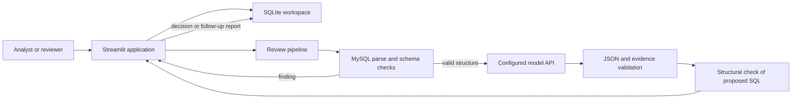
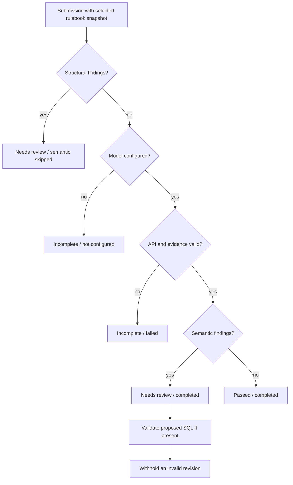
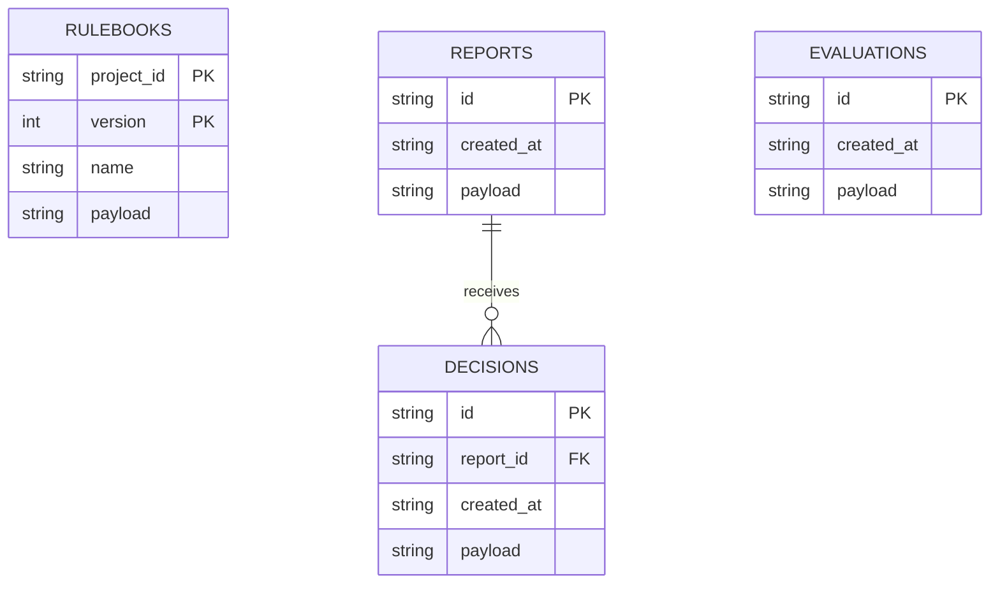

# System design

## Purpose and boundaries

TeamGuard helps an analytics team review SQL produced by different coding assistants against a shared standard. It inspects one MySQL query, not the assistant's conversation. The application never opens a business-database connection or executes submitted SQL. SQLite is used only to store workspace records through parameterized statements.

The current implementation is a local course prototype. There is no production authentication, tenant isolation, automatic query execution, arbitrary Python execution or automatic merge into another repository.

## Components

| Module | Responsibility | Main boundary |
| --- | --- | --- |
| `contracts.py` | Immutable typed request/report/rule/decision contracts | Reject extra model fields and invalid values |
| `checks.py` | Parse MySQL, restrict statements/functions, resolve schema references | No database execution |
| `model_client.py` | Configuration, prompts, HTTP call, response and evidence validation | Keep credentials outside reports |
| `review.py` | Orchestrate structural → semantic → revision checking | Incomplete is distinct from passed |
| `storage.py` | Local transactions, version/report/decision/evaluation storage | Persist exact context snapshots |
| `benchmarks.py` | Synthetic schema, illustrative rules and frozen case definitions | No production or personal records |
| `evaluation.py` | Three-strategy comparison and explicit metric definitions | Do not turn failures into passes |
| `app.py` | Project editing, submission, report, history and evaluation views | Human judgment is explicit |
| `manage.py` | Benchmark execution and SQLite backup | Model calls only for selected B/C evaluations |

## Review state machine

A report marked passed means completed checks found no issues; it is not an execution result or a guarantee. Accepting suggestions records a decision only. Re-reviewing proposed SQL creates a new report linked by `parent_report_id`; neither the original SQL nor its rulebook is overwritten.

## Storage design

Payloads are serialized validated contracts. Each report embeds the submitted SQL and entire rulebook version. That snapshot preserves meaning even if the project later changes. `parent_report_id` is a logical report link inside the payload, not a database foreign key. Evaluation payloads contain the frozen cases, labels, schema/rules, model settings, attempts and optional manual fix judgments.

Rulebook saves use an immediate transaction and require the next version number. Two simultaneous edits cannot both create the same next version; the losing edit must reload. SQLite writes serialize and connections close after each operation. This supports a small local team workspace, not a distributed service.

## GenAI design choices

The model receives the full small approved context. This is context-grounded prompting, **not vector retrieval or RAG**. It returns constrained JSON, and every finding must cite an existing rule, an exact rule-text substring and an exact submitted-SQL substring. Validating those strings proves provenance, not that the reasoning is relevant.

Only the policy-aware pipeline applies the deterministic gate before calling the model. The generic baseline receives SQL and schema but no business rules. The same configured model and generation parameters are used for B and C.

Proposed SQL passes through the structural checker again. It is not silently executed or certified as business-correct. The human decision and re-review controls address that remaining uncertainty.

## Presentation design

The interface uses a dark green navigation rail, a restrained green action color and light content panels. The six pages mirror the review lifecycle rather than mixing project setup, evidence and evaluation into a chat window. Severity/status labels include text; color is not the only signal. Reports separate findings, SQL revision and provenance into tabs. History shows the original version and latest decision.

Empty and failure states have a concrete next action: create a project, enter a query, configure the model, fix structural issues or retry a failed review. Only user-created projects and executed reviews are stored in the workspace. Historical test reports are separate PDFs. See [the showcase script](SHOWCASE.md) for the intended demonstration order.

## Known limits and next decisions

- Parser acceptance is not proof that MySQL will execute a query; engine-specific semantics and data-dependent behavior remain outside the checks.
- The safety denylist covers common dangerous constructs, not every possible side-effecting user-defined function.
- The schema is small and unqualified; only explicit `CREATE TABLE` definitions are supported.
- SQL and rules can contain prompt-injection attempts. Instruction separation and evidence validation reduce risk but do not eliminate semantic manipulation.
- Reviewer aliases are not authenticated identities. Evaluation fix judgments can be updated and are not a tamper-evident audit log.
- Local SQLite files are durable on one machine, but not synchronized between members.
- External user validation, a held-out test set and human-checked fix correctness must precede broader effectiveness claims.
